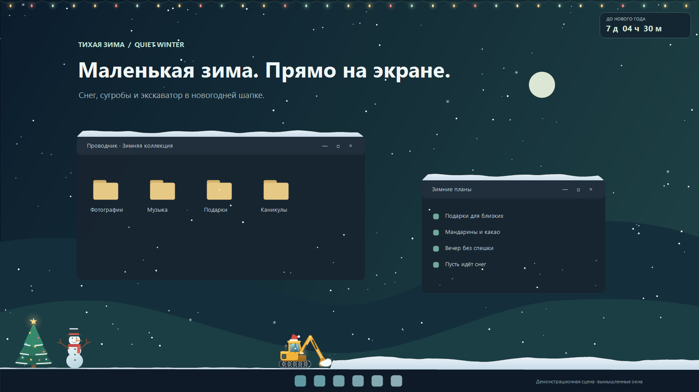
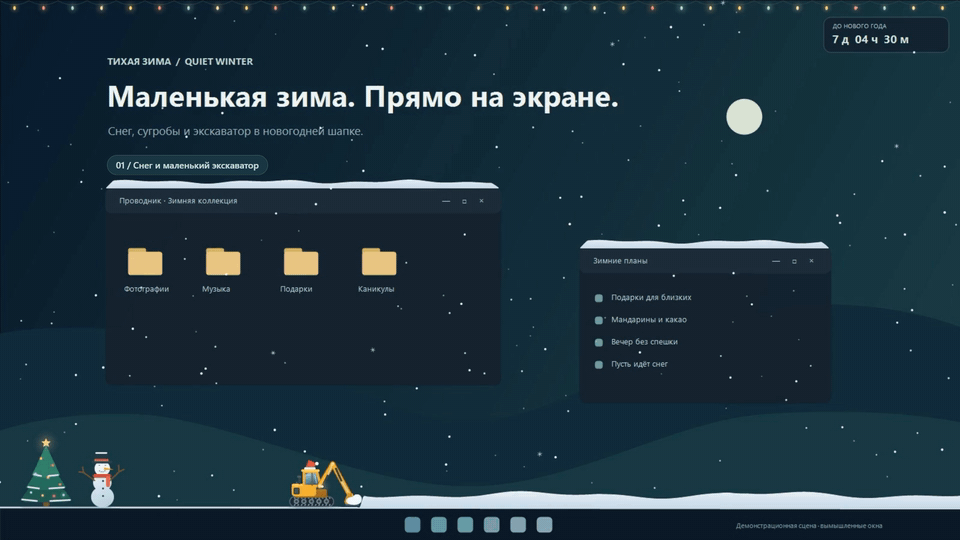
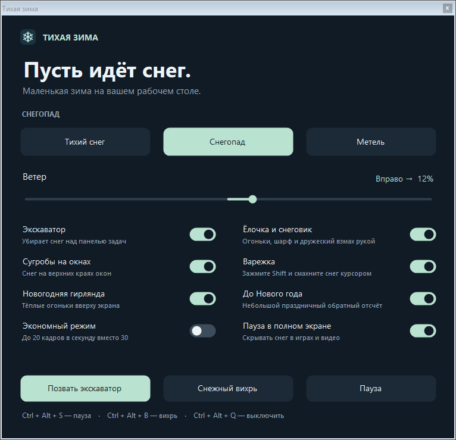

<div align="center">

# ❄️ Тихая зима

### Маленькая зима. Прямо на экране.

Падающий снег, сугробы на окнах и экскаватор в новогодней шапке.<br>
Уютное приложение для рабочего стола Windows, которое пропускает клики.

[](https://github.com/Zaplavs/quiet-winter/releases/latest)
[](https://github.com/Zaplavs/quiet-winter/releases/latest)
[](https://github.com/Zaplavs/quiet-winter/actions/workflows/build.yml)


**[⬇ Скачать приложение](https://github.com/Zaplavs/quiet-winter/releases/latest) · [▶ Видео MP4](docs/media/demo.mp4) · [💬 Telegram](https://t.me/+ay37cKnFWtg3MDJi) · [☕ Поддержать](https://www.donationalerts.com/r/ruszaphack)**



<sub>Вымышленный рабочий стол, нарисованный приложением. Личные окна и файлы в кадр не попадали.</sub>

</div>

## Зима в движении



**[Открыть 14-секундное видео MP4 →](docs/media/demo.mp4)**

В ролике работает тот же движок снега, что и в приложении. Фон, Проводник и заметки вымышлены: запись настоящего экрана не использовалась. [Как созданы материалы](docs/MEDIA.md).

## Что здесь происходит

| | |
| --- | --- |
| **🌨 Снег с характером** | Тихие снежинки, обычный снегопад или метель. Ветер плавно меняет направление. |
| **🏔 Сугробы на окнах** | Снег ложится на верхние края, перемещается вместе с окнами и скрывается за перекрывающими их окнами. |
| **🚜 Маленький экскаватор** | Ездит над панелью задач, сгребает снег ковшом, разбрасывает крошку и возвращается с другой стороны. |
| **🧤 Варежка** | Зажмите **Shift** и проведите курсором по сугробу. Снег разлетится, а клики продолжат попадать в ваши программы. |
| **🌀 Снежный вихрь** | Нажмите **Ctrl + Alt + B**: снег закружится на несколько секунд и вернётся к выбранной погоде. |
| **🎄 Ёлочка и снеговик** | Мерцающие огоньки, звезда, тёплый шарф и снеговик, который машет рукой. |
| **✨ Новогодняя гирлянда** | Тёплые цветные огоньки вдоль верхнего края экрана. |
| **🕛 Ожидание праздника** | Небольшой отсчёт дней, часов и минут. Первого января — поздравление с Новым годом. |

Украшения, таймер и варежку можно отключить по отдельности. Есть экономный режим, поддержка нескольких мониторов и автоматическая пауза над полноэкранными приложениями.

## Запустить за минуту

1. Откройте **[последний релиз](https://github.com/Zaplavs/quiet-winter/releases/latest)**.
2. Скачайте `QuietWinter.exe` или распакуйте `QuietWinter-windows-x64.zip`.
3. Запустите приложение двойным щелчком. В первый раз откроются настройки.

Нужна **Windows 10/11 x64** с системным **.NET Framework 4.x**. Установка, права администратора, Python и Node.js для обычного запуска не нужны. `.exe` можно хранить прямо на рабочем столе.

Закрытие окна настроек оставляет снег включённым. Снова открыть его можно двойным щелчком по снежинке в трее рядом с часами. Если значок скрыт, нажмите стрелку `^`.

## Управление

| Действие | Как сделать |
| --- | --- |
| Пауза / продолжить | **Ctrl + Alt + S** или меню снежинки |
| Снежный вихрь | **Ctrl + Alt + B**, кнопка в настройках или меню снежинки |
| Смахнуть снег | **Shift + движение курсора** по сугробу |
| Позвать экскаватор | Кнопка в настройках или меню снежинки |
| Мгновенно убрать сугробы | Меню снежинки → «Убрать все сугробы» |
| Выключить приложение | **Ctrl + Alt + Q** или меню снежинки → «Выключить» |

Ковш экскаватора убирает снег внизу экрана. Для сугробов на окнах пригодится варежка. Если горячая клавиша занята другой программой, используйте настройки или меню в трее.

<details>
<summary><strong>Посмотреть окно настроек</strong></summary>



</details>

## Спокойно работать, красиво отдыхать

- Прозрачный слой пропускает клики и не захватывает фокус.
- В играх и полноэкранном видео снег автоматически скрывается, если включена соответствующая настройка.
- При блокировке сеанса анимация останавливается.
- Экономный режим ограничивает частоту обновления до 20 кадров в секунду; обычный режим — до 30.
- В автозагрузку приложение себя не добавляет.

Сугробы ограничены по высоте, число снежинок — по количеству. Конкретная нагрузка зависит от разрешения, числа мониторов и выбранного снегопада.

## Личное остаётся личным

Приложение работает **без сети, аккаунта и телеметрии**. Для сугробов оно получает границы и порядок видимых окон, но не читает их содержимое. Для варежки проверяются только положение курсора и состояние Shift; ввод не записывается и не сохраняется.

Настройки хранятся локально в `%LOCALAPPDATA%\QuietWinter\settings.json`. При ошибке создаётся локальный `error.log`.

Публичные изображения и видео созданы отдельно через `DemoScene.cs` и `DrawToBitmap`. В репозиторий не включены записи личного рабочего стола, реальные пользовательские файлы, локальные настройки и журналы.

## Собрать самому

```powershell
git clone https://github.com/Zaplavs/quiet-winter.git
cd quiet-winter
.\build.ps1
.\dist\QuietWinter.exe
```

Сборка использует компилятор .NET Framework, входящий в Windows, без скачивания NuGet-пакетов. Исходники — C#, WinForms, GDI+ и Win32. Графика рисуется кодом; для обычной работы внешние изображения, движки и кодеки не нужны.

```text
src/                 Движок снега, отрисовка, окно настроек и Win32
assets/              Значок приложения
tests/               Проверки репозитория и интерфейса Windows
docs/media/          Безопасные скриншоты, GIF и видео
media-project/       Исходная композиция оформления видео
build.ps1            Сборка одним вызовом
install-desktop.ps1  Копирование .exe на рабочий стол
```

### Проверки

```powershell
.\build.ps1
New-Item -ItemType Directory artifacts -Force | Out-Null
$test = Start-Process .\dist\QuietWinter.exe -ArgumentList '--self-test', "$PWD\artifacts\self-test.json" -Wait -PassThru
if ($test.ExitCode -ne 0) { throw 'Проверки не прошли' }
python .\tests\check_repository.py
```

Встроенные проверки покрывают накопление снега, уборку ковшом и варежкой, перекрытие и движение окон, координаты мониторов, полноэкранные границы, вихрь, таймер, совместимость настроек и альфа-прозрачность.

`python tests/ui_smoke.py` проверяет интерфейс в настоящей сессии Windows. Перед этим завершите обычный экземпляр приложения. Проверка полного экрана пропускается с объяснением, если Windows оставляет фокус у другой программы.

## Telegram и поддержка

**[💬 Telegram-канал проекта](https://t.me/+ay37cKnFWtg3MDJi)** — новости, обновления и общение.

**[☕ Поддержать разработку через DonationAlerts](https://www.donationalerts.com/r/ruszaphack)** — если эта маленькая зима добавила вам настроения. Спасибо за поддержку!

Ошибки и идеи можно оставлять в **[Issues](https://github.com/Zaplavs/quiet-winter/issues)**.

---

<div align="center">

Сделано для тихих зимних вечеров. ❄️<br>
Автор: [Zaplavs](https://github.com/Zaplavs) · [Что нового](CHANGELOG.md)

<sub>Вдохновлено идеей снега на рабочем столе и примером <a href="https://tryflake.ru/">Flake</a>. Код и графика созданы отдельно; это самостоятельный проект.</sub>

</div>
